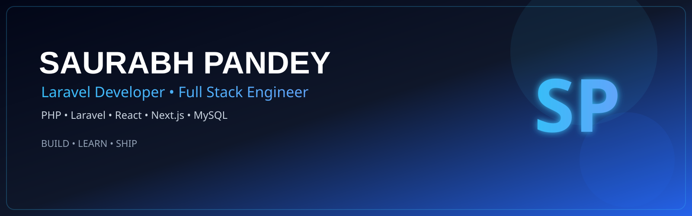

 

 

  

Laravel Developer | PHP Full Stack Developer | Problem Solver

Turning ideas into reliable, scalable and user-friendly web applications.

👨‍💻 About Me
yaml
name: Saurabh Pandey
role: Laravel Developer
experience: 1.5+ years
location: India

backend:
  - PHP
  - Laravel
  - REST APIs

frontend:
  - JavaScript
  - React
  - Next.js
  - Tailwind CSS
  - Bootstrap

databases:
  - MySQL
  - MongoDB

currently_learning:
  - TypeScript
  - System Design

interests:
  - Scalable Web Applications
  - Backend Development
  - API Development
  - Clean Code
  - Continuous Learning

🔭 Building modern web applications with Laravel and PHP.
⚙️ Interested in backend architecture, REST APIs and database optimization.
🌱 Exploring React, Next.js, TypeScript and system design.
🤝 Open to collaborating on meaningful web development projects.
💬 Happy to discuss Laravel, PHP, MySQL and full-stack development.
🛠️ Tech Stack
Languages

Frontend Development

Backend Development

Databases

Tools & Platforms

🚀 Featured Projects
🎓 Top Universities in India

A university discovery platform inspired by education portals such as CollegeDunia and Shiksha.

University discovery and information pages.
SEO-friendly page structure.
Admin panel for content management.
Responsive user interface.

Tech Stack: Laravel · MySQL · Bootstrap · JavaScript

<!-- Replace the repository URL above with the actual project repository. -->

🏨 Hotel The Spark

A hotel management and booking platform designed to streamline room discovery and reservations.

User authentication.
Room management.
Booking workflow.
Administrative dashboard.

Tech Stack: PHP · MySQL · Bootstrap · JavaScript

<!-- Replace with the actual Hotel The Spark repository URL. -->

📝 Blog Management System

A Laravel-based content management system for creating, organizing and managing blog posts.

Authentication and protected pages.
Create, read, update and delete operations.
Category management.
Dashboard for content administration.

Tech Stack: Laravel · PHP · MySQL

🛒 E-Commerce Platform

An online shopping application with essential shopping workflows and administrative functionality.

User authentication.
Shopping cart.
Order management.
Admin dashboard.

Tech Stack: Laravel · MySQL · JavaScript

Project links: Replace the source-code links above with each project's actual GitHub repository URL. Add live-demo links only when a working deployment is available.
💼 Professional Experience
Company	Role	Duration
Digital Brain Media	Laravel Developer	Jun 2026 – Present
Websofy Software Pvt. Ltd.	Laravel Developer	Oct 2025 – Jun 2026
DigiCoders Technologies	PHP Full Stack Developer	Mar 2025 – Oct 2025

Experience dates are based on the information provided and should be updated whenever your employment details change.

📊 GitHub Analytics

  

📈 Contribution Activity

🐍 Contribution Snake

🤝 Connect With Me

  

Thanks for visiting my profile! Feel free to explore my repositories and connect with me.

